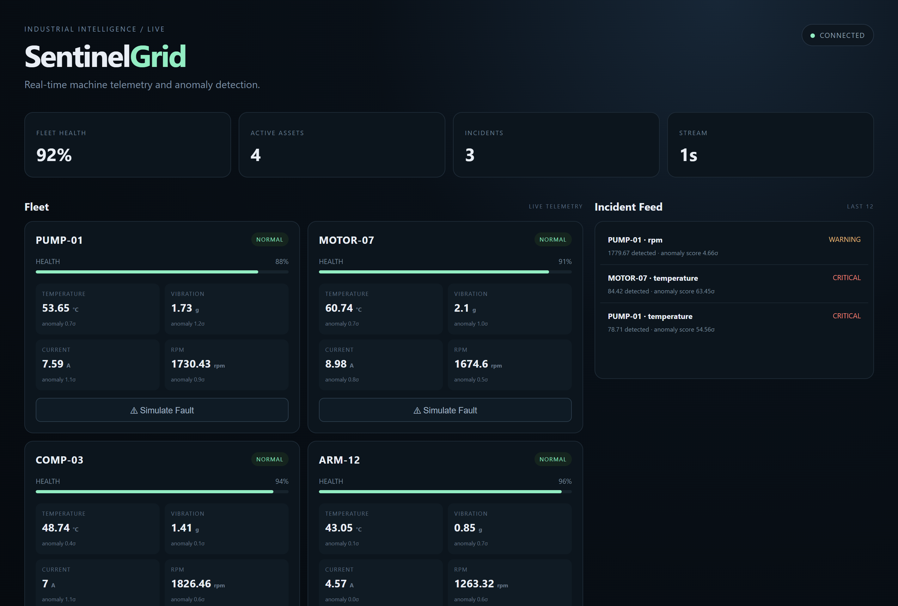
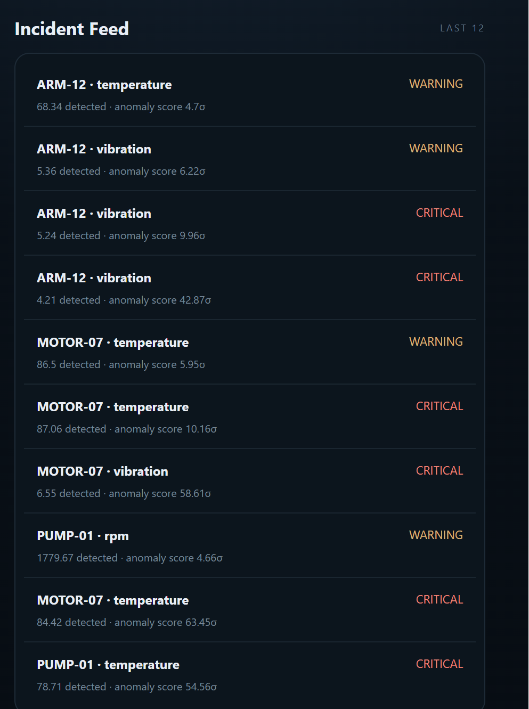
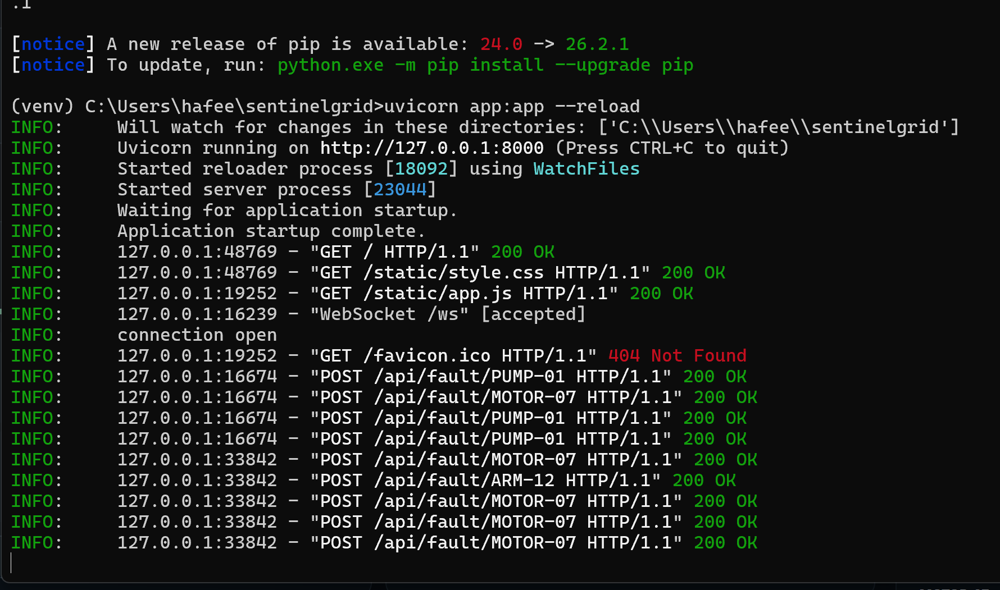

# ⚡ SentinelGrid

### Real-Time Industrial Telemetry & Anomaly Detection

<p align="center">

**Monitor machines. Detect abnormal behavior. Simulate failures. Respond in real time.**

SentinelGrid is a real-time industrial monitoring platform that simulates a fleet of machines, streams live telemetry, detects abnormal operating conditions, and visualizes machine health through an interactive operations dashboard.

</p>

<p align="center">


</p>

---

## 🎯 What is SentinelGrid?

Industrial machines constantly generate data.

Temperature.

Vibration.

Current.

RPM.

Pressure.

The difficult part is not collecting the data.

The difficult part is turning that stream of numbers into something an operator can actually understand.

**SentinelGrid explores that problem through a simulated industrial environment.**

The system continuously generates machine telemetry, analyzes the incoming data for abnormal behavior, calculates machine health, and presents everything through a live monitoring dashboard.

It also includes a **fault simulation system**, allowing failures to be introduced intentionally and observed as they propagate through the monitoring pipeline.

---

# 🖥️ Dashboard

The main dashboard provides a live overview of the simulated industrial fleet.

It displays machine status, health, telemetry and active incidents in one place.



---

# 🚨 Anomaly Detection

When machine telemetry moves outside expected operating conditions, SentinelGrid identifies the abnormal behavior and surfaces it as an incident.



---

# ⚠️ Fault Simulation

Instead of waiting for a failure to happen naturally, the system allows faults to be simulated intentionally.

This makes it possible to test the monitoring pipeline and observe how the system reacts to abnormal machine behavior.



---

# ✨ Features

## 📡 Real-Time Telemetry

Machines continuously generate simulated operational data including:

- 🌡️ Temperature
- 📳 Vibration
- ⚡ Current
- 🔄 RPM
- ❤️ Machine health
- 🟢 Machine status

Telemetry is continuously streamed to the dashboard.

---

## 🧠 Anomaly Detection

SentinelGrid analyzes incoming telemetry and identifies values that deviate from expected operating conditions.

Detected anomalies can trigger:

- Warning states
- Machine health degradation
- Active incidents
- Visual alerts
- Operator attention

The goal is to demonstrate how raw machine telemetry can be transformed into actionable information.

---

## 🚨 Incident Detection

Instead of simply displaying abnormal numbers, SentinelGrid turns anomalies into operational incidents.

An incident contains information such as:

```text
Machine
↓
Abnormal metric
↓
Detected value
↓
Severity
↓
Timestamp


🏭 Machine Fleet Simulation

The project includes a simulated fleet of industrial machines.

Each machine behaves independently and produces its own telemetry stream.

This makes it possible to experiment with:

Multiple machines
Different operating conditions
Abnormal behavior
Machine failures
Fleet-wide monitoring
⚡ Fault Injection

SentinelGrid includes a fault simulation mechanism.

A fault can intentionally push a machine outside normal operating conditions.

For example:

Normal Operation
       ↓
Fault Injected
       ↓
Temperature ↑
Vibration ↑
       ↓
Anomaly Detected
       ↓
Machine Health ↓
       ↓
Incident Created
       ↓
Dashboard Alert

This allows the entire monitoring pipeline to be demonstrated without requiring physical industrial hardware.

📊 Live Operations Dashboard

The dashboard provides a centralized view of the simulated environment.

Operators can quickly identify:

Which machines are healthy
Which machines require attention
Current telemetry
Active anomalies
Machine health
Recent incidents
🧠 How It Works

SentinelGrid is built around a continuous telemetry pipeline.

┌─────────────────────┐
│  Machine Simulator  │
└──────────┬──────────┘
           │
           │ Telemetry
           ▼
┌─────────────────────┐
│   FastAPI Backend   │
└──────────┬──────────┘
           │
           ├──────────────────┐
           │                  │
           ▼                  ▼
┌─────────────────┐   ┌──────────────────┐
│ Anomaly Engine  │   │ Machine Health   │
└────────┬────────┘   └─────────┬────────┘
         │                      │
         └──────────┬───────────┘
                    │
                    ▼
             ┌─────────────┐
             │  WebSocket  │
             │    Stream   │
             └──────┬──────┘
                    │
                    ▼
          ┌────────────────────┐
          │ Operations         │
          │ Dashboard          │
          └────────────────────┘
🔄 Telemetry Pipeline

The system can be thought of as five stages.

1. Generate

The simulator generates machine telemetry.

Temperature
Vibration
Current
RPM
2. Stream

The backend continuously processes the incoming machine data.

3. Analyze

The anomaly detection layer evaluates the telemetry and looks for abnormal operating conditions.

4. Classify

The system determines machine health and whether an operational incident should be created.

5. Visualize

The dashboard receives the latest state and presents it to the operator.

🏗️ Architecture
                     SENTINELGRID
                           │
                           ▼
                ┌────────────────────┐
                │ Machine Simulator   │
                │                    │
                │ Temperature        │
                │ Vibration          │
                │ Current            │
                │ RPM                │
                └─────────┬──────────┘
                          │
                          ▼
                ┌────────────────────┐
                │    FastAPI App     │
                │                    │
                │ API + WebSockets   │
                └─────────┬──────────┘
                          │
              ┌───────────┴───────────┐
              │                       │
              ▼                       ▼
    ┌──────────────────┐    ┌──────────────────┐
    │ Anomaly Detection│    │ Machine Health   │
    │                  │    │ Calculation      │
    └────────┬─────────┘    └────────┬─────────┘
             │                       │
             └───────────┬───────────┘
                         │
                         ▼
                ┌────────────────────┐
                │ Incident Manager   │
                └─────────┬──────────┘
                          │
                          ▼
                ┌────────────────────┐
                │ WebSocket Stream   │
                └─────────┬──────────┘
                          │
                          ▼
                ┌────────────────────┐
                │ Operations         │
                │ Dashboard          │
                └────────────────────┘
🛠️ Technology Stack
Backend
Python
FastAPI
WebSockets
Uvicorn
Frontend
HTML
CSS
JavaScript
WebSocket API
Monitoring & Detection
Real-time telemetry processing
Rule-based anomaly detection
Machine health calculation
Fault injection
Incident generation
Development
Git
GitHub
Python virtual environments
📁 Project Structure
sentinelgrid/
│
├── assets/
│   ├── dashboard.png
│   ├── anomaly-detection.png
│   └── fault-simulation.png
│
├── static/
│   └── frontend assets
│
├── app.py
│   └── FastAPI application and realtime communication
│
├── simulator.py
│   └── Machine telemetry simulation
│
├── anomaly.py
│   └── Anomaly detection logic
│
├── requirements.txt
│
├── LICENSE
│
└── README.md
🚀 Getting Started
1. Clone the repository
git clone https://github.com/hadi-ce04/sentinelgrid.git
cd sentinelgrid
2. Create a virtual environment
Windows
python -m venv venv
venv\Scripts\activate
macOS / Linux
python3 -m venv venv
source venv/bin/activate
3. Install dependencies
pip install -r requirements.txt
4. Start the server
uvicorn app:app --reload
5. Open the dashboard

Open:

http://127.0.0.1:8000

You should now see the SentinelGrid operations dashboard.

🧪 Testing the System

Once the dashboard is running:

Step 1

Observe the machines operating normally.

Step 2

Select a machine and trigger a simulated fault.

Step 3

Watch its telemetry change.

Step 4

The anomaly detection layer identifies the abnormal state.

Step 5

The machine health changes and an incident is generated.

Step 6

The dashboard reflects the new machine state in real time.

This creates a complete test loop:

User Action
    ↓
Fault Injection
    ↓
Telemetry Changes
    ↓
Anomaly Detection
    ↓
Health Update
    ↓
Incident
    ↓
Dashboard Alert
💡 Why I Built This

I wanted to explore what happens when software moves beyond static applications and starts interacting with continuously changing environments.

A traditional application often looks like:

User
 ↓
Request
 ↓
Response

SentinelGrid explores a different model:

Environment
     ↓
Continuous Data
     ↓
Analysis
     ↓
Decision
     ↓
Action

That architecture is relevant to many real-world systems including:

Industrial monitoring
Predictive maintenance
Robotics
IoT
Smart infrastructure
Autonomous systems
Edge computing
📚 What I Learned

Building SentinelGrid helped me explore several concepts beyond basic application development.

Real-Time Systems

Instead of waiting for a user request, the application continuously receives and processes changing data.

Event-Driven Architecture

Machine state changes can trigger downstream events such as anomaly detection and incident creation.

WebSockets

WebSockets allow the dashboard to receive live updates without repeatedly polling the backend.

Anomaly Detection

Even relatively simple detection rules can transform raw telemetry into useful operational information.

Fault Injection

Simulating failures provides a controlled way to test how monitoring systems respond to abnormal conditions.

System Design

The project required thinking about the complete data flow rather than treating the frontend and backend as isolated components.

🔮 Future Development

SentinelGrid is intentionally designed as a foundation that can be extended toward real hardware and more advanced intelligence.

Potential future directions include:

🤖 AI-Powered Anomaly Detection

Replace static detection rules with machine-learning models trained on historical telemetry.

🔮 Predictive Maintenance

Estimate the probability of machine failure before an actual fault occurs.

📡 Real IoT Sensors

Connect real sensors through:

ESP32
Raspberry Pi
Arduino
MQTT
🦾 Robotics Integration

Use the monitoring infrastructure as part of a robotic fleet or autonomous system.

🧠 AI Incident Assistant

Allow an AI system to explain:

What happened?
Why did it happen?
How severe is it?
What should the operator check?
☁️ Distributed Deployment

Move from a local simulation to a distributed telemetry architecture using containers and cloud infrastructure.

🎯 Project Goals

SentinelGrid was built to explore the intersection of:

Software
   +
Real-Time Systems
   +
AI / Data Analysis
   +
Automation
   +
Industrial Systems

The long-term idea is to evolve the prototype from a simulated monitoring environment into a system capable of processing telemetry from real machines.

👨‍💻 Author

Hadi

Computer Engineering Student

Interested in:

Artificial Intelligence
Robotics
Computer Vision
Automation
Real-Time Systems
Software Engineering

GitHub:
https://github.com/hadi-ce04

📄 License

This project is licensed under the MIT License.

<p align="center">

SentinelGrid ⚡

Turning machine telemetry into operational awareness.

</p>
